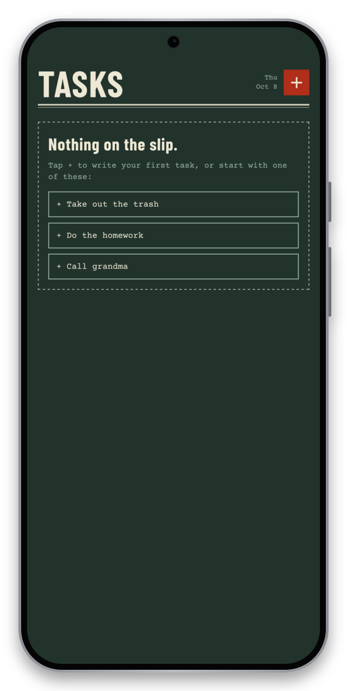
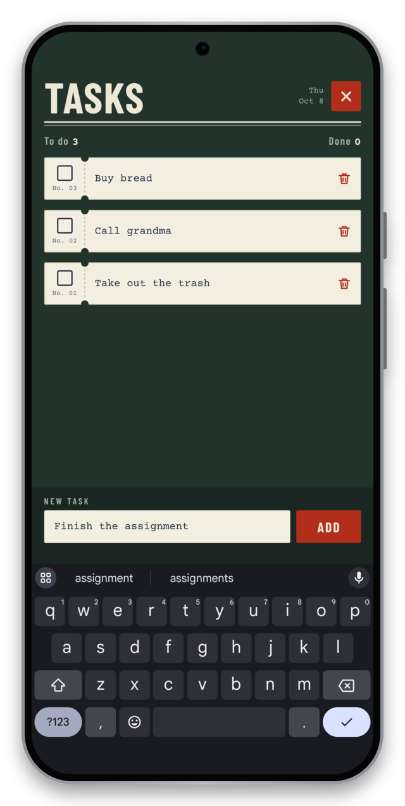
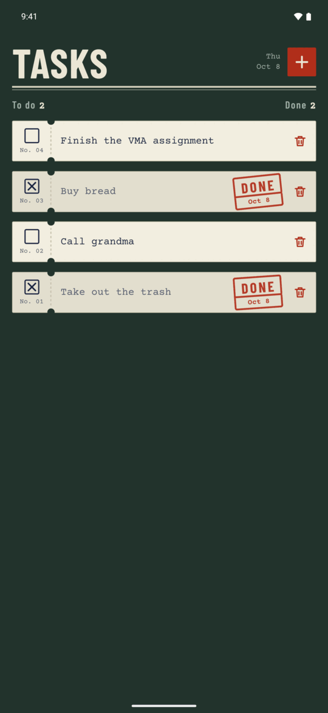
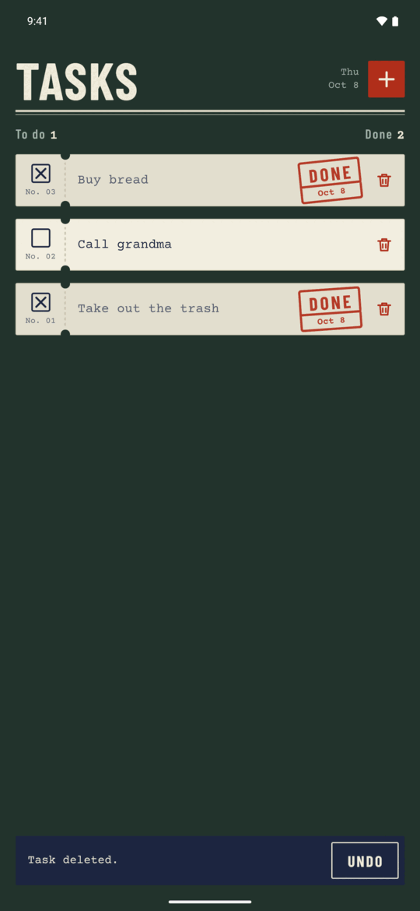

<a id="readme-top"></a>

<br />
<div align="center">
  <a href="https://github.com/dankouwu/stamp">
    
  </a>

  <h3 align="center">Stamp</h3>

  <p align="center">
    A TODO app where every task is a paper slip and finishing one means stamping it.
    <br />
    <a href="#about-the-project"><strong>See the screens »</strong></a>
    <br />
    <br />
    <a href="https://github.com/dankouwu/stamp/releases/latest">Download the APK</a>
    &middot;
    <a href="https://github.com/dankouwu/stamp/issues">Report a bug</a>
  </p>
</div>

<details>
  <summary>Table of contents</summary>
  <ol>
    <li>
      <a href="#about-the-project">About the project</a>
      <ul>
        <li><a href="#built-with">Built with</a></li>
      </ul>
    </li>
    <li><a href="#install">Install</a></li>
    <li><a href="#usage">Usage</a></li>
    <li><a href="#development">Development</a></li>
    <li><a href="#project-structure">Project structure</a></li>
    <li><a href="#roadmap">Roadmap</a></li>
    <li><a href="#acknowledgments">Acknowledgments</a></li>
  </ol>
</details>

## About the project

<table>
  <tr>
    <td align="center"><br><sub>Empty list</sub></td>
    <td align="center"><br><sub>New task</sub></td>
    <td align="center"><br><sub>Stamped tasks</sub></td>
    <td align="center"><br><sub>Undo a delete</sub></td>
  </tr>
</table>

Stamp is a mobile TODO app built with Expo and React Native for a school assignment. It does what the assignment lists: add a task (an empty one is refused), show the list, mark a task done, delete a task, and look like something other than the default template.

The look is a green desk with cream paper slips on it. Each slip has a tear-off stub with a checkbox and a serial number that is never reused. Finishing a task puts a red DONE stamp on it with the date it was finished.

A few choices that are not obvious from the screenshots:

- The whole slip is the done button, not just the checkbox, so there is no small target to hit.
- Deleting does not ask for confirmation. The slip goes away and an UNDO button stays for five seconds. A restored slip returns to its old position with its old number.
- An empty task is not blocked by a greyed-out button. The button stays pressable, and pressing it says what is missing under the field.
- Tasks are saved on the device and are still there after a restart.
- With reduced motion turned on in the phone settings, the animations are skipped.

<p align="right">(<a href="#readme-top">back to top</a>)</p>

### Built with

* [Expo](https://expo.dev/) SDK 57
* [React Native](https://reactnative.dev/) 0.86
* [react-native-svg](https://github.com/software-mansion/react-native-svg) for the checkbox, the perforation and the icons
* [AsyncStorage](https://react-native-async-storage.github.io/async-storage/) for saving the list
* [expo-haptics](https://docs.expo.dev/versions/latest/sdk/haptics/) for the tap you feel when the stamp comes down
* Barlow Condensed and Courier Prime from [Google Fonts](https://fonts.google.com/)

<p align="right">(<a href="#readme-top">back to top</a>)</p>

## Install

1. On an Android phone, open the [latest release](https://github.com/dankouwu/stamp/releases/latest) and download `stamp-1.0.0.apk`.
2. Open the downloaded file. If Android asks, allow your browser or file manager to install apps.
3. Tap Install, then open Stamp.

It needs Android 7.0 or newer. The APK is signed with a debug key and is not on Google Play, so Android or Play Protect may show a warning before installing. That is expected for an app installed from a file.

**iPhone:** there is no installable file. Apple only allows that through a paid developer account. The app code is the same on both systems, so on an iPhone you run it from source inside Expo Go, as described under [Development](#development).

<p align="right">(<a href="#readme-top">back to top</a>)</p>

## Usage

1. Tap the red **+** at the top right. The new task field opens above the keyboard.
2. Type a task and press **ADD** or the keyboard's done key. The field closes and the new slip appears at the top.
3. Tap a slip to stamp it as done. Tap it again to take the stamp off.
4. Tap the red trash icon to delete a slip. Press **UNDO** within five seconds to bring it back.

The release APK has been installed and run on an Android 15 emulator. An earlier build of the same code ran on an Android 14 phone through Expo Go. It has not been run on iOS.

<p align="right">(<a href="#readme-top">back to top</a>)</p>

## Development

To run from source you need [Node.js](https://nodejs.org/) LTS and the Expo Go app, with a version that matches SDK 57.

```sh
git clone https://github.com/dankouwu/stamp.git
cd stamp
npm install
npx expo start
```

Scan the QR code with Expo Go. The phone and the computer must be on the same network. If that fails, `npx expo start --tunnel` works around it.

To build the APK yourself you need JDK 17 and the Android SDK:

```sh
npx expo prebuild --platform android
cd android
./gradlew assembleRelease
```

The file ends up in `android/app/build/outputs/apk/release/`.

<p align="right">(<a href="#readme-top">back to top</a>)</p>

## Project structure

```text
App.js                  screen, list, adding and deleting
src/useTasks.js         task state and saving
src/storage.js          reading and writing AsyncStorage
src/motion.js           reduced-motion check and list animation
src/dates.js            weekday and day-month labels
src/theme.js            colors and fonts
src/components/
  Header.js             title row, date, + button, counters
  Slip.js               one task: stub, text, stamp, trash
  Stamp.js              the DONE stamp and its landing animation
  Composer.js           new task field and its validation
  Presence.js           slide and fade for the field and the toast
  Toast.js              the "Task deleted" message with UNDO
  EmptyState.js         what the list shows with no tasks
```

<p align="right">(<a href="#readme-top">back to top</a>)</p>

## Roadmap

- [x] Add, list, mark done, delete
- [x] Save tasks on the device
- [x] Undo for deletes
- [ ] Edit the text of an existing task
- [ ] Clear all done tasks at once
- [x] A standalone Android build
- [ ] An iPhone build

<p align="right">(<a href="#readme-top">back to top</a>)</p>

## Acknowledgments

* [Best-README-Template](https://github.com/othneildrew/Best-README-Template) for the layout of this file
* Barlow Condensed and Courier Prime, both under the SIL Open Font License

<p align="right">(<a href="#readme-top">back to top</a>)</p>
